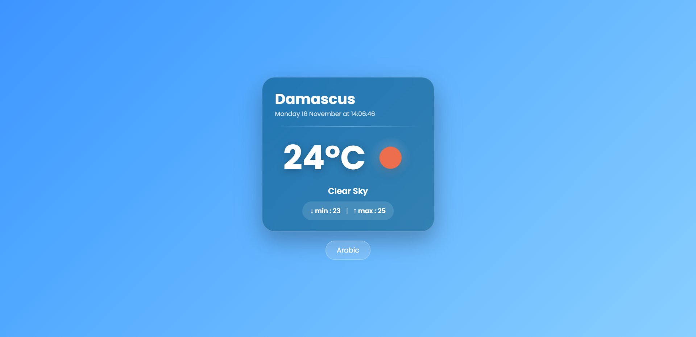

## Screenshots

<p >
  
  
</p>

# 🌤️ Damascus Weather App

A responsive weather application built with **React** and **OpenWeatherMap API**, providing real-time weather information for Damascus, Syria.

The application supports Arabic and English, displays live date and time in Damascus timezone, and dynamically changes its background according to current weather conditions.

## ✨ Features

- 🌡️ Real-time temperature, minimum and maximum temperatures.
- 🌥️ Current weather description and weather icon.
- 🌍 Bilingual support (Arabic and English).
- ↔️ Automatic RTL/LTR layout switching.
- 🕒 Live clock displaying Damascus local time.
- 🌈 Dynamic background colors based on weather conditions.
- 💾 Saves the selected language using Local Storage.
- 📱 Responsive design for different screen sizes.
- ⚡ Cancels outdated API requests using AbortController.

## 🛠️ Technologies Used

- React
- JavaScript (ES6+)
- Vite
- Axios
- React i18next
- OpenWeatherMap API
- HTML5
- CSS3

## 🚀 Getting Started

### 1. Clone the repository

```bash
git clone https://github.com/Aghiad98/WeatherWebb
```

### 2. Navigate to the project directory

```bash
cd damascus-weather-app
```

### 3. Install dependencies

```bash
npm install
```

### 4. Configure environment variables

Create a `.env` file in the root directory:

```env
VITE_OPENWEATHER_API_KEY=your_api_key_here
```

Get your API key from [OpenWeatherMap](https://openweathermap.org/api).

### 5. Run the development server

```bash
npm run dev
```

## 📸 Preview

The application provides Arabic and English interfaces with weather information displayed in a responsive weather card.

## 📌 Future Improvements

- Add support for searching different cities.
- Display additional weather information such as humidity and wind speed.
- Add loading and error states.
- Improve weather animations and transitions.

## 👨‍💻 Author

Created as a frontend development learning project using React and modern JavaScript.